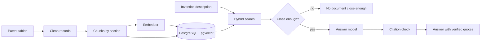

# Similar Patent Finder

You describe an invention in a few lines. The tool searches a collection of patents, shows the closest ones, and quotes the exact passage that makes each of them close. Every quote is checked against the patent text before it is shown.

A word on vocabulary. In patent work, "prior art" means any earlier public document that shows an invention already exists. In French it is an antériorité. "Art" here has nothing to do with painting. It is the old sense of a craft or a body of technical knowledge.

## Why I built it

Before filing a patent, an attorney looks for earlier patents that describe the same thing. Keyword search misses a lot, because the same idea gets written in different words. A wireless charger is also called an inductive power transfer device.

Search on meaning fixes part of that. The risk is that a language model makes up a source or calls a document relevant when it is not. Someone who signs the advice cannot use an answer they cannot check. So the rule in this project is simple: no quote is shown unless the program finds it word for word in the patent.

I also wanted numbers. The project is measured against patents that examiners themselves cited, and the results below are the real ones, including the ones that are not flattering.

## What it does

Given a description, it returns up to ten patents. For each one you see the best matching passages. In the second mode, a language model also writes a short comment on what is close and what is different, with one quote per patent. If nothing in the collection is close enough, it says so instead of guessing.

There is a command line, and a small web page for people who prefer a browser.

## How it works

Patent texts are cut into pieces, one per abstract and one per claim, and each piece keeps its patent number and position. Each piece is turned into a vector of numbers by an embedding model, so that pieces with similar meaning get similar vectors. Text, vectors and a keyword index all live in one PostgreSQL database with the pgvector extension.

A search runs twice, once by keywords and once by vectors, and the two rankings are merged with reciprocal rank fusion. The best passages go to a language model, which must answer in JSON with an excerpt copied from a passage. The program then looks for each excerpt in the passage it came from, after normalizing spaces and quote styles. An excerpt that is not found is dropped and the whole answer is flagged as unreliable. If even the best vector similarity is under a threshold, the tool abstains.



The embedder and the answer model sit behind two small interfaces, `Embedder` and `Answerer`, so changing a model is a setting and not a code change.

## Running it

You need Python 3.11 or newer and Docker.

```bash
git clone https://github.com/guillaumeoudin/similar-patent-finder.git
cd similar-patent-finder
python -m venv .venv && source .venv/bin/activate   # on Windows: .venv\Scripts\activate
pip install -e ".[dev]"
cp .env.example .env
docker compose -f docker_compose.yml up -d
```

The embedder is chosen with `EMBEDDER` in `.env`. `local` runs an open model on your machine, needs no key and is the default (`pip install -e ".[local]"`). `voyage` and `mistral` call a web API and need a key. Only the local one is measured below.

Once the data is in place (see the next section):

```bash
python eval/build_dataset.py      # picks the evaluation corpus
python -m priorart.ingest         # builds clean records
priorart index                    # prints the size and a cost estimate, sends nothing
priorart index --yes              # embeds and stores
priorart search "a charging pad with a coil that detects metal objects"
priorart answer "a charging pad with a coil that detects metal objects"
```

The answer step can use a Claude subscription through the `claude` command line tool (`ANSWERER=claude-code`, the default), or an API key (`ANSWERER=api`). The command line mode cannot set the temperature, so two runs can differ.

The web page needs `pip install -e ".[api]"`, then `uvicorn priorart.api:app`, and opens at http://127.0.0.1:8000. It listens on the local machine only and has no login, so do not expose it to a network. The embeddings can also be computed on a different machine and copied over, see `docs/gpu_machine.md`.

Tests and the development evaluation:

```bash
ruff check .
pytest -q
python eval/run_eval.py --set dev
```

## Data

The patents come from the PatentsView tables, distributed by the USPTO Open Data Portal. I kept one narrow field, wireless power transfer (CPC group H02J 50), for patents granted from 2015 to 2025. The raw files are not in this repository. You download them yourself from the portal, which needs a free USPTO.gov account, and put them in `data/raw/`. The list of tables is in `DATA_LICENSES.md`, along with the license statement, the date I accessed the data and what I could and could not verify.

Data derived from PatentsView. This project is not endorsed by, or affiliated with, PatentsView or the USPTO.

## How I measure it

The answer key is the list of references that the patent examiner cited in each patent, restricted to references that are in my corpus. I took 70 patents with a fixed random seed, each with 3 to 8 such references: 20 for development, where I tune settings, and 50 for testing, which I run once at the very end. A query is a patent's abstract plus its first claim, without its references, and the patent itself is removed from the results. The corpus has 500 patents: the 70 queries, their expected references, and random patents from the same field.

For abstention I wrote twenty descriptions of things that are not in the corpus. The first ten are plainly off topic and were used to set the threshold. The last ten describe other electrical devices, such as wired charging or solar inverters, and were kept aside only to be reported.

## Results

The test set has not been run yet, so there is no test result here. These are development numbers, on 20 queries, with the open model `intfloat/multilingual-e5-small` (384 dimensions) computed on my own GPU. I tuned the settings on these same queries, so the numbers are optimistic.

| System | Recall at 5 | Recall at 10 | MRR |
|---|---|---|---|
| Keywords only, BM25 in Python | 0.41 | 0.49 | 0.68 |
| Keywords only, PostgreSQL full text search | 0.41 | 0.45 | 0.73 |
| Vectors only | 0.43 | 0.52 | 0.76 |
| Hybrid (k = 60, 50 candidates) | 0.40 | 0.47 | 0.80 |

With 20 queries, a gap of a few points is noise, and the four rows are close. The hybrid search puts the first correct patent higher up (MRR 0.80), but it does not find more of the expected patents than vectors alone. I had expected the hybrid to win more clearly, and on this set it does not.

One mistake worth telling. My first PostgreSQL keyword search cut the query to its first 60 terms and ranked with `ts_rank_cd`, and it reached only 0.35 recall at 10, well below the plain Python baseline. Using every term with `ts_rank` and length normalization brought it to 0.45.

The abstention threshold is 0.862 cosine similarity, halfway between the weakest development query (0.892) and the closest of the ten off-topic descriptions (0.832). On the ten held-out descriptions the tool abstained ten times out of ten, and it never abstained on the 20 real queries. Ten hand-written descriptions say little about harder cases.

Search takes 0.38 s per query with the local model, and costs nothing.

The answer step was run on the same 20 queries through a Claude subscription. It returned 34 quotes, and all 34 were found word for word in the source. None was rejected and none of the 20 answers was flagged. A query takes 8.2 s from search to answer. A verified quote proves the text is in the cited patent. It does not prove that the comment on what is close and different is right, and I only read that part by hand on one example. The token count I measured (405,000 in, 12,500 out) includes the overhead of the command line tool, so a direct API call would use less.

## Where it fails

I read 15 missed references from the keyword baseline by hand, picked at random (`eval/failure_analysis_bm25_dev.md`). Seven were the same idea in other words, for example "cloth" and "fabric", or "mousepad" and "mouse pad". Six were references only loosely related to the query, such as a mechanical part cited against an electrical one. One was a different sub-technology, and one was a query that was mostly about something else. About half of the misses look like something a meaning-based search can fix. The other half no similarity search should be expected to find, which puts a ceiling on recall. This reading was done by one person, on the baseline and not on the final system. A new one will follow the test run.

## Limits

The answer key only counts examiner citations that point to a patent inside my field and inside my corpus. Most citations point elsewhere, and a cited patent is not always the closest one, so the key measures agreement with examiners and not truth. Only abstracts and claims are indexed. The description files are very large, so descriptions are out, and a passage that exists only in a description cannot be found. Dependent claims such as "the device of claim 1, wherein" say little on their own. The corpus is small, 500 patents, so the results will not carry over as they are to millions of documents. The threshold is tuned on 20 queries. It covers US patents in English only.

## Disclaimer

This is a technical project. It does not tell you whether an invention is new or patentable, and it should not be used to make legal decisions.

## Next

Compare the API embedders with open models served from a remote GPU machine, on recall, citation quality, speed and cost. Add a reranker. Index description paragraphs.
