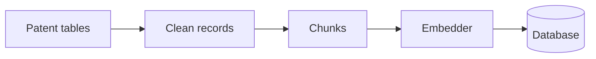
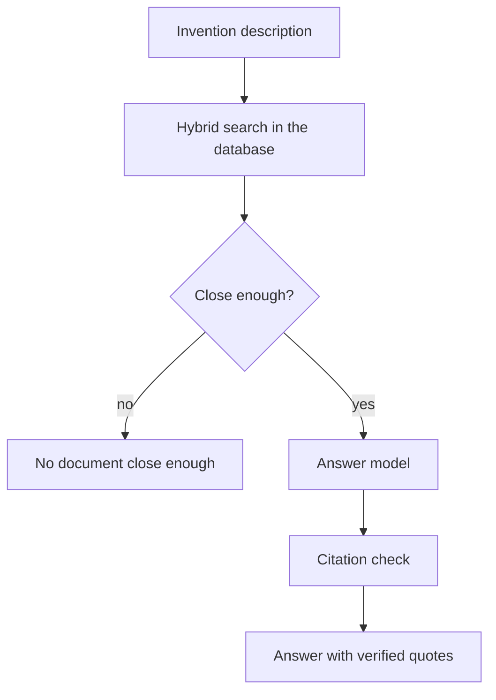

# Similar Patent Finder

You describe an invention in a few lines. The tool searches a collection of patents, shows the closest ones, and quotes the exact passage that makes each of them close. Every quote is checked against the patent text before it is shown.

A word on vocabulary. In patent work, "prior art" means any earlier public document that shows an invention already exists. In French it is an antériorité. "Art" here has nothing to do with painting. It is the old sense of a craft or a body of technical knowledge.

## Why I built it

Before filing a patent, an attorney looks for earlier patents that describe the same thing. Keyword search misses a lot, because the same idea gets written in different words. A wireless charger is also called an inductive power transfer device.

Search on meaning fixes part of that. The risk is that a language model makes up a source or calls a document relevant when it is not. Someone who signs the advice cannot use an answer they cannot check. So the rule in this project is simple: no quote is shown unless the program finds it word for word in the patent.

I also wanted numbers. The project is measured against patents that examiners themselves cited, and the results below are the real ones, including the ones that are not flattering.

## What it does

Given a description, it returns up to ten patents. For each one you see the best matching passages. In the second mode, a language model also writes a short comment on what is close and what is different, with one quote per patent. If nothing in the collection is close enough, it says so instead of guessing.

There is a command line, and a small web page for people who prefer a browser.

## How it works

Patent texts are cut into pieces, one per abstract and one per claim, and each piece keeps its patent number and position. Each piece is turned into a vector of numbers by an embedding model, so that pieces with similar meaning get similar vectors. Text, vectors and a keyword index all live in one PostgreSQL database with the pgvector extension.

A search runs twice, once by keywords and once by vectors, and the two rankings are merged with reciprocal rank fusion. The best passages go to a language model, which must answer in JSON with an excerpt copied from a passage. The program then looks for each excerpt in the passage it came from, after normalizing spaces and quote styles. An excerpt that is not found is dropped and the whole answer is flagged as unreliable. If even the best vector similarity is under a threshold, the tool abstains.

Preparing the collection, done once:



Answering a description:



The embedder and the answer model sit behind two small interfaces, `Embedder` and `Answerer`, so changing a model is a setting and not a code change.

## Running it

You need Python 3.11 or newer and Docker.

```bash
git clone https://github.com/guillaumeoudin/similar-patent-finder.git
cd similar-patent-finder
python -m venv .venv && source .venv/bin/activate   # on Windows: .venv\Scripts\activate
pip install -e ".[dev]"
cp .env.example .env
docker compose -f docker_compose.yml up -d
```

The embedder is chosen with `EMBEDDER` in `.env`. `local` runs an open model on your machine, needs no key and is the default (`pip install -e ".[local]"`). `voyage` and `mistral` call a web API and need a key. The local one and Voyage are measured below, Mistral is implemented but was never run, because its free plan no longer gives API access. A Voyage account without a payment method is limited to 3 requests and 10,000 tokens a minute, which is too little to index the corpus at a normal pace. `VOYAGE_RPM` and `VOYAGE_TPM` make the code slow down to fit such limits.

Once the data is in place (see the next section):

```bash
python eval/build_dataset.py      # picks the evaluation corpus
python -m priorart.ingest         # builds clean records
priorart index                    # prints the size and a cost estimate, sends nothing
priorart index --yes              # embeds and stores
priorart search "a charging pad with a coil that detects metal objects"
priorart answer "a charging pad with a coil that detects metal objects"
```

The answer step can use a Claude subscription through the `claude` command line tool (`ANSWERER=claude-code`, the default), or an API key (`ANSWERER=api`, which needs `pip install -e ".[anthropic]"`). The command line mode cannot set the temperature, so two runs can differ.

The web page needs `pip install -e ".[api]"`, then `uvicorn priorart.api:app`, and opens at http://127.0.0.1:8000. It listens on the local machine only and has no login, so do not expose it to a network. The embeddings can also be computed on a different machine and copied over, see `docs/gpu_machine.md`.

Tests and the development evaluation:

```bash
ruff check .
pytest -q
python eval/run_eval.py --set dev
```

## What is in the repository

`src/priorart` holds the code: `ingest.py` and `chunking.py` prepare the texts, `embeddings.py` and `store.py` handle vectors and PostgreSQL, `search.py` does the rank fusion, `answer.py` writes the answer and checks every quote, `cli.py` and `api.py` are the two entry points, and `static/` is the web page. `eval/` has the scripts that build the evaluation sets, tune settings and run the evaluation, with every log in `eval/results/`. `prompts/` holds the prompts as text files. `tests/` has 58 tests. One test file needs the database running and is skipped when it is not.

## Data

The patents come from the PatentsView tables, distributed by the USPTO Open Data Portal. I kept one narrow field, wireless power transfer (CPC group H02J 50), for patents granted from 2015 to 2025. The raw files are not in this repository. You download them yourself from the portal, which needs a free USPTO.gov account, and put them in `data/raw/`. The list of tables is in `DATA_LICENSES.md`, along with the license statement, the date I accessed the data and what I could and could not verify.

Data derived from PatentsView. This project is not endorsed by, or affiliated with, PatentsView or the USPTO.

## How I measure it

The answer key is the list of references that the patent examiner cited in each patent, restricted to references that are in my corpus. I took 70 patents with a fixed random seed, each with 3 to 8 such references. A query is a patent's abstract plus its first claim, without its references, and the patent itself is removed from the results. The corpus has 500 patents: the 70 queries, their expected references, and random patents from the same field.

The 70 are split in two. 20 are the development set. I used them to try things, tune settings and set the abstention threshold. 50 are the test set, which I ran at the very end, once per system, after the settings were frozen. That is why the two sets give different numbers: the development numbers were tuned on, and the test numbers were not.

For abstention I wrote twenty descriptions of things that are not in the corpus. The first ten are plainly off topic and were used to set the threshold. The last ten describe other electrical devices, such as wired charging or solar inverters, and were kept aside only to be reported.

## Results

### Test set, 50 queries

Every system below ran once on the test set. Recall at 10 comes with a 95 percent interval from resampling the 50 queries.

| System | Recall at 5 | Recall at 10 | MRR |
|---|---|---|---|
| Keywords only, BM25 in Python | 0.32 | 0.37 (0.28 to 0.46) | 0.49 |
| Keywords only, PostgreSQL full text search | 0.27 | 0.32 (0.24 to 0.40) | 0.43 |
| Vectors only, e5-small (open model, local) | 0.29 | 0.35 (0.26 to 0.44) | 0.40 |
| Vectors only, voyage-4-lite (web API) | 0.35 | 0.43 (0.34 to 0.52) | 0.52 |
| Hybrid, e5-small | 0.32 | 0.36 (0.27 to 0.45) | 0.42 |
| Hybrid, voyage-4-lite | 0.33 | 0.42 (0.33 to 0.51) | 0.47 |

The honest reading is that no system clearly beats the others. The intervals overlap, including the plain BM25 baseline. The two Voyage systems score a few points higher than BM25 (vectors only: 0.43 against 0.37, a gap of 0.06 with an interval of minus 0.01 to plus 0.13), but 50 queries cannot confirm it. The hybrid search is a hair above each of its halves with e5-small (0.36 against 0.35 and 0.32) and a hair below its vector half with Voyage (0.42 against 0.43), gaps well inside the noise. I had expected a clearer win. The open model on its own GPU is no better than BM25 here.

The test numbers are lower than the development ones (hybrid with e5-small: recall at 10 of 0.36 against 0.47, MRR of 0.42 against 0.80). That is what tuning on 20 queries does, and it is why I kept a test set.

### Cited answers, test set

The answer step ran on the hybrid search of both models, through a Claude subscription (`ANSWERER=claude-code`).

| | e5-small | voyage-4-lite |
|---|---|---|
| Quotes returned | 101 | 125 |
| Found word for word in the source | 100 | 124 |
| Answers flagged unreliable | 1 of 50 | 1 of 50 |
| Queries where the model quoted nothing | 7 | 2 |
| Seconds per query, search and answer | 10.2 | 11.5 |

In each run one quote was not found in the source. The program dropped it and flagged the answer, which is the behavior I wanted, and I did not look into why the model produced it. A verified quote proves the text is in the cited patent. It does not prove that the comment on what is close and different is right. I only read that part by hand on one example.

### Abstention, test set

| | e5-small | voyage-4-lite |
|---|---|---|
| Threshold (cosine similarity) | 0.862 | 0.569 |
| Real test queries that got no answer | 0 of 50 | 0 of 50 |
| Held-out electrical descriptions that got no answer | 10 of 10 | 9 of 10 |

The e5 similarities all sit between 0.80 and 0.97 in the development set, so its threshold rests on a gap of 0.06. Voyage spreads them wider, with a gap of 0.21. Ten hand-written descriptions say little about harder cases.

### Development set, 20 queries

These are the numbers I tuned on, so they are optimistic.

| System | Embedder | Recall at 5 | Recall at 10 | MRR |
|---|---|---|---|---|
| Keywords only, BM25 | none | 0.41 | 0.49 | 0.68 |
| Keywords only, PostgreSQL | none | 0.41 | 0.45 | 0.73 |
| Vectors only | e5-small | 0.43 | 0.52 | 0.76 |
| Vectors only | voyage-4-lite | 0.43 | 0.48 | 0.71 |
| Hybrid (k = 60, 50 candidates) | e5-small | 0.40 | 0.47 | 0.80 |
| Hybrid (k = 60, 50 candidates) | voyage-4-lite | 0.42 | 0.50 | 0.76 |

One mistake worth telling. My first PostgreSQL keyword search cut the query to its first 60 terms and ranked with `ts_rank_cd`, and it reached only 0.35 recall at 10, well below the plain Python baseline. Using every term with `ts_rank` and length normalization brought it to 0.45.

### Cost and speed

Search takes 0.38 s per query with the local model and 1.1 s with Voyage, which includes the network call. The local model costs nothing. Voyage gives 200 million free tokens on this model and the corpus is about 960,000 tokens, but the account needed a payment method for normal rate limits, so I added a small prepaid balance. I did not check the billing page for the exact charge.

## Where it fails

I read 15 missed references by hand, drawn at random from the final test run (`eval/failure_analysis_final.md`). In that run, 130 of the 208 expected references were not in the top 10.

Eleven of the 15 were patents of the same field that cover another aspect of wireless charging than the query: a circuit against a coil structure, a display against a coil material. Two were the same idea in other words or only just outside the top 10, and two came from a query that was thin or mostly about something else. An examiner often cites a patent as background and not because it describes the same invention. No method that looks for the closest document should be expected to find those, so they cap the recall of every system on this answer key.

Seven of the 15 ranked between 9 and 29, close to the cut. One of them, about heat dissipation, ranks 9 when I fetch 100 candidates and was missed with the 50 used in the run. The development numbers had hinted that 100 candidates helped Voyage a little, and I kept 50 for both models without re-tuning after seeing the test set. This reading was done by one person, which makes the sorting a judgment call.

## Limits

The answer key only counts examiner citations that point to a patent inside my field and inside my corpus. Most citations point elsewhere, and a cited patent is not always the closest one, so the key measures agreement with examiners and not truth. Only abstracts and claims are indexed. The description files are very large, so descriptions are out, and a passage that exists only in a description cannot be found. Dependent claims such as "the device of claim 1, wherein" say little on their own. The corpus is small, 500 patents, so the results will not carry over as they are to millions of documents. Fifty test queries give wide intervals. The threshold is tuned on 20 queries. It covers US patents in English only.

## Disclaimer

This is a technical project. It does not tell you whether an invention is new or patentable, and it should not be used to make legal decisions.

## Next

Compare the API embedders with open models served from a remote GPU machine, on recall, citation quality, speed and cost. Add a reranker. Index description paragraphs.
