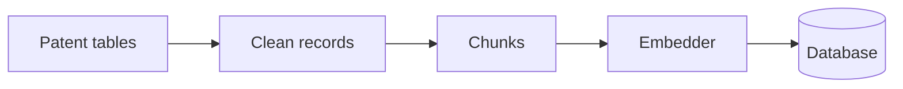
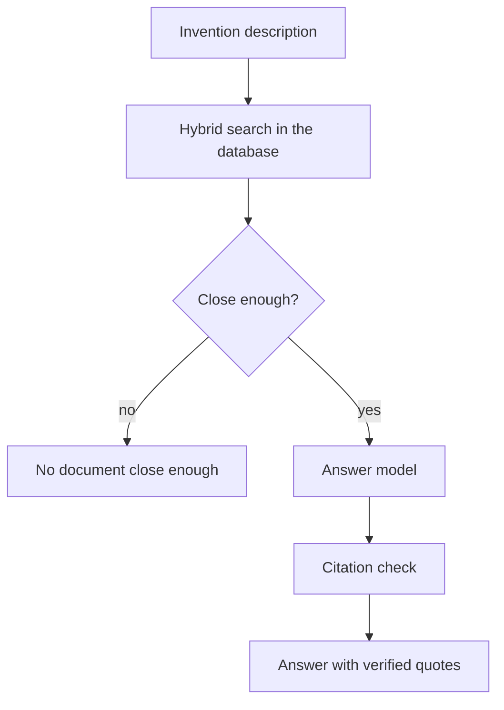

# Similar Patent Finder

You describe an invention in a few lines. The tool searches a collection of patents, shows the closest ones, and quotes the exact passage that makes each of them close. Every quote is checked against the patent text before it is shown.

## The problem

A patent gives its owner the exclusive right to use an invention, but only if the invention is new. So before filing, and again while the office examines the application, someone has to answer one question: has anything like this already been described? Any earlier public document that shows an invention already exists is called **prior art**. In French it is an antériorité. ("Art" here is the old sense of a craft or a body of technical knowledge, nothing to do with painting.)

Finding prior art is slow and easy to get wrong, for two reasons.

- **The same idea is written in different words.** A wireless charger is also an inductive power transfer device, and a keyword search for one misses the other.
- **A wrong answer is costly.** Someone who signs a legal opinion cannot rely on a source they cannot check. A language model that invents a patent, or calls a document relevant when it is not, is worse than no tool at all.

## What the tool does

You paste a description of an invention. It returns up to ten patents, closest first. For each one you see the passages that match best.

In a second mode, a language model also writes a short comment on what is close and what is different, with one quote per patent. The quote is not taken on trust: the program looks for it word for word in the patent text. A quote it cannot find is dropped and the whole answer is flagged as unreliable.

If nothing in the collection is close enough, the tool says so instead of guessing.

There is a command line, and a small web page for people who prefer a browser.

## How I tested it

A tool like this is easy to demo and hard to judge. So I measured it against a record that already exists: what patent examiners actually found.

**Who the examiner is.** When someone files a patent application, an employee of the patent office (here the USPTO, in the United States) reviews it. The examiner searches for earlier patents that show the idea is not new, and lists the ones they retain on the granted patent, under "references cited". It is the same job the tool is meant to do. The inventor's side cites patents too, but I kept only the ones marked as cited by the examiner.

**The test, step by step.**

1. I took a patent, call it P. The examiner cited 5 earlier patents for it, and those 5 are in my collection. That list of 5 is the **answer key**. The tool never sees it.
2. I gave the tool P's abstract (its short summary) plus its **claim 1** (the legal sentence that defines what the patent protects). To the tool this looks like a new invention to check.
3. The tool ranks the other patents in the collection from closest to least close, with P itself removed. That ranked list is the **results**, and the **top 10** are the ten patents at its head, the ones a user would see first.
4. I count how many of the 5 patents in the answer key are in the top 10. If 2 are, the score for this patent is 2 out of 5, or 0.4.
5. I repeat this on many patents and average.

I used 70 patents chosen with a fixed random seed, each with 3 to 8 examiner citations inside the collection. The collection itself has 500 patents: those 70, the patents they cite, and random ones from the same field.

**Two sets, on purpose.** 20 of the 70 are the **development set**. I used them to try ideas and tune settings, so scores on them are flattering. The other 50 are the **test set**. I ran it once per system, at the very end, after every setting was frozen. Those are the numbers that count.

**Two scores.**

- **Found in the top 10** (called recall at 10 in the literature). The share of the answer key that shows up in the first ten results. 0.43 means that, on average, 43 percent of the patents the examiner cited appear there. The same idea applies to the top 5.
- **Ranking score** (called MRR). It rewards putting a cited patent high in the list. If the first cited patent is in first place the score is 1, in second place 0.5, in tenth place 0.1. It is averaged over all patents.

With only 50 test patents, a score can move by chance. So I give a plausible range for each one. When two ranges overlap, the difference may be luck.

## Results

### In plain words

- **It finds about four in ten.** The best systems recover 37 to 43 percent of the patents the examiner cited, in their top ten. Six in ten are missed. This is a measured starting point and not a finished product.
- **Searching by meaning did not clearly beat searching by keywords.** The best meaning model scores 43 percent and plain keyword search 37 percent. With 50 patents a gap that size can be luck, so I do not claim one is better.
- **Most misses are not search errors.** I read 15 of them. Eleven were patents from the same field that the examiner cited as background, not because they describe the same invention. No tool that looks for the closest document would find those.
- **The quotes can be trusted.** Out of 226 quotes the model produced, 224 were found word for word in the cited patent. The two that were not were removed and the answer was flagged.
- **It declines when nothing matches.** On 10 descriptions of electrical devices that are not in the collection, it declined all 10 times with the open model and 9 times with the paid one. It never declined a real query. Ten descriptions is a small check.

What I take from it: on a collection this small, the choice of model matters less than I expected. What the project does show is that quotes can be checked and that the measurement is honest, including where it is unflattering.

### The systems I compared

- **Keyword search.** Looks for the words of the description in the patent text and favors rare words. I tried a textbook version written in Python (BM25) and the one built into the database (PostgreSQL full text search).
- **Meaning search.** An **embedding** model turns a piece of text into a list of numbers, so that texts with a similar meaning get similar numbers. Search then means finding the pieces closest to the description. Two models: **e5-small**, an open model that runs on my own machine for free, and **voyage-4-lite**, a paid web service.
- **Hybrid.** Runs both searches and merges the two rankings.

### Test set, 50 patents

Each system ran once. The range in brackets is a 95 percent interval obtained by resampling the 50 patents.

| System | Found in top 5 | Found in top 10 | Ranking score |
|---|---|---|---|
| Keywords, BM25 in Python | 0.32 | 0.37 (0.28 to 0.46) | 0.49 |
| Keywords, in the database | 0.27 | 0.32 (0.24 to 0.40) | 0.43 |
| Meaning only, e5-small (open, local) | 0.29 | 0.35 (0.26 to 0.44) | 0.40 |
| Meaning only, voyage-4-lite (web service) | 0.35 | 0.43 (0.34 to 0.52) | 0.52 |
| Hybrid, e5-small | 0.32 | 0.36 (0.27 to 0.45) | 0.42 |
| Hybrid, voyage-4-lite | 0.33 | 0.42 (0.33 to 0.51) | 0.47 |

No system clearly beats the others, because the ranges overlap, plain BM25 included. The meaning search with the paid model scores 0.06 above BM25 in the top 10, with a plausible range of minus 0.01 to plus 0.13, which does not settle it. Merging the two searches did not help much either: a hair above each half with the open model, a hair below its meaning half with the paid one. I had expected a clearer win.

The test scores are lower than the development ones (hybrid with e5-small: 0.36 against 0.47 in the top 10, ranking score 0.42 against 0.80). That is what tuning on 20 patents does, and it is why I kept a test set.

### The cited answers

For each of the 50 test patents, a language model (Claude, through a subscription) was given the closest passages and asked to comment, with quotes. I then checked every quote against the source.

| | With e5-small | With voyage-4-lite |
|---|---|---|
| Quotes the model gave | 101 | 125 |
| Quotes found word for word in the patent | 100 | 124 |
| Answers flagged unreliable | 1 of 50 | 1 of 50 |
| Patents where the model gave no quote at all | 7 | 2 |
| Time for search plus answer | about 10 s | about 11 s |

In each run one quote was not found. The program dropped it and flagged the answer, which is the behavior I wanted. I did not look into why the model produced it. A verified quote proves the text is in the cited patent. It does not prove that the comment about what is close and different is right. I read that part by hand on one example only.

### Declining to answer

The tool compares the description with the closest passage in the collection. If even that passage is not similar enough, it says nothing matches. The cutoff was set on the development set.

To test it I wrote 20 descriptions of things that are not in the collection. The first ten, plainly off topic, were used to set the cutoff. The other ten describe nearby electrical devices, such as wired charging or solar inverters, and were kept aside only to be reported.

| | With e5-small | With voyage-4-lite |
|---|---|---|
| Real test patents wrongly declined | 0 of 50 | 0 of 50 |
| Unrelated descriptions correctly declined | 10 of 10 | 9 of 10 |

The open model's scores are bunched together, so its cutoff rests on a narrow margin. The paid model spreads them wider. Ten hand written descriptions say little about harder cases. The technical detail is in `docs/technical_notes.md`.

### Cost and speed

Search takes under half a second per description with the open model and about a second with the paid one, which includes the network call. The open model costs nothing. The paid model offers a large free allowance that covers this collection many times over, but the account needed a payment method for normal speed limits, so I added a small prepaid balance. I did not check the billing page for the exact charge.

## Where it fails

I read 15 missed references by hand, drawn at random from the final test run (`eval/failure_analysis_final.md`). In that run, 130 of the 208 expected references were not in the top 10.

Eleven of the 15 were patents of the same field that cover another aspect of wireless charging than the description: a circuit against a coil structure, a display against a coil material. An examiner often cites a patent as background and not because it describes the same invention. No method that looks for the closest document should be expected to find those, so they cap what any system can score on this answer key. Two were the same idea in other words or just outside the top 10, and two came from a description that was thin or mostly about something else.

Seven of the 15 ranked between 9 and 29, close to the cut. A longer candidate list or a reranking step could recover some of them. One of them, about heat dissipation, would rank 9th with a longer list and was missed with the one used in the run. I kept the same settings and did not re-tune after reading the test set. I read these cases alone, so the sorting is a judgment call.

## Limits

- The answer key only counts examiner citations that point to a patent inside my field and my collection. Most citations point elsewhere, and a cited patent is not always the closest one. The key measures agreement with examiners, not truth.
- Only abstracts and claims are indexed, not the long descriptions. A passage that exists only in a description cannot be found.
- Dependent claims such as "the device of claim 1, wherein" say little on their own.
- The collection is small, 500 patents, so these results will not carry over as they are to millions of documents.
- Fifty test patents give wide ranges, and the cutoff for declining was tuned on 20.
- US patents in English only.

## How it works

Patent texts are cut into pieces, one per abstract and one per claim, each keeping its patent number. Each piece becomes a list of numbers through the embedding model. Text, numbers and a keyword index all live in one PostgreSQL database with the pgvector extension.

A search runs twice, once by keywords and once by meaning, and the two rankings are merged with reciprocal rank fusion. The best passages go to a language model, which must answer in JSON with an excerpt copied from a passage. The program looks for each excerpt in the passage it came from, after normalizing spaces and quote styles. If even the best match is under the cutoff, the tool abstains.

Preparing the collection, done once:



Answering a description:



The embedding model and the answer model sit behind two small interfaces, `Embedder` and `Answerer`, so changing a model is a setting and not a code change.

## Running it

You need Python 3.11 or newer and Docker.

```bash
git clone https://github.com/guillaumeoudin/similar-patent-finder.git
cd similar-patent-finder
python -m venv .venv && source .venv/bin/activate   # on Windows: .venv\Scripts\activate
pip install -e ".[dev,local]"
cp .env.example .env
docker compose -f docker_compose.yml up -d
```

The embedding model is chosen with `EMBEDDER` in `.env`. `local` runs an open model on your machine, needs no key and is the default. `voyage` and `mistral` call a web service and need a key. The open model and Voyage are measured above. Mistral is implemented but was never run, because its free plan no longer gives API access. A Voyage account without a payment method is limited to 3 requests and 10,000 tokens a minute, which is too little to index the collection at a normal pace. `VOYAGE_RPM` and `VOYAGE_TPM` make the code slow down to fit such limits.

Once the data is in place (see the next section):

```bash
python eval/build_dataset.py      # picks the evaluation collection
python -m priorart.ingest         # builds clean records
priorart index                    # prints the size and a cost estimate, sends nothing
priorart index --yes              # embeds and stores
priorart search "a charging pad with a coil that detects metal objects"
priorart answer "a charging pad with a coil that detects metal objects"
```

The answer step can use a Claude subscription through the `claude` command line tool (`ANSWERER=claude-code`, the default), or an API key (`ANSWERER=api`, which needs `pip install -e ".[anthropic]"`). The command line mode cannot set the temperature, so two runs can differ.

The web page needs `pip install -e ".[api]"`, then `uvicorn priorart.api:app`, and opens at http://127.0.0.1:8000. It listens on the local machine only and has no login, so do not expose it to a network. The embeddings can also be computed on a different machine and copied over, see `docs/gpu_machine.md`.

Tests and the development evaluation:

```bash
ruff check .
pytest -q
python eval/run_eval.py --set dev
```

## What is in the repository

`src/priorart` holds the code: `ingest.py` and `chunking.py` prepare the texts, `embeddings.py` and `store.py` handle the numbers and PostgreSQL, `search.py` merges the rankings, `answer.py` writes the answer and checks every quote, `cli.py` and `api.py` are the two entry points, and `static/` is the web page. `eval/` has the scripts that build the evaluation sets, tune settings and run the evaluation, with every log in `eval/results/`. `prompts/` holds the prompts as text files. `docs/` has the technical notes. `tests/` has 58 tests. One test file needs the database running and is skipped when it is not.

## Data

The patents come from the PatentsView tables, distributed by the USPTO Open Data Portal. I kept one narrow field, wireless power transfer (CPC group H02J 50), for patents granted from 2015 to 2025. The raw files are not in this repository. You download them yourself from the portal, which needs a free USPTO.gov account, and put them in `data/raw/`. The list of tables is in `DATA_LICENSES.md`, along with the license statement, the date I accessed the data and what I could and could not verify.

Data derived from PatentsView. This project is not endorsed by, or affiliated with, PatentsView or the USPTO.

## Disclaimer

This is a technical project. It does not tell you whether an invention is new or patentable, and it should not be used to make legal decisions.

## Next

Compare the web service models with open models served from a remote GPU machine, on accuracy, citation quality, speed and cost. Add a reranking step. Index description paragraphs.
