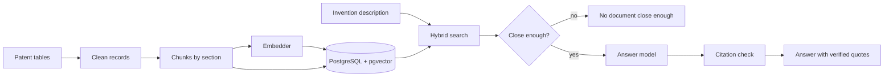

# Similar Patent Finder (V1 demo)

Prior art search over patents, with citations checked against the source text. A small, measured tool that finds patents close to an invention description and shows the exact passage that justifies each match.

"Prior art" is the trade word for any earlier public document that shows an invention already exists. "Art" here means the existing technical knowledge of a field, not painting or music.

This is a demonstration project, not a product. It does not give legal advice.

**Status:** data, chunking, indexing, search and evaluation run end to end on the development set with an open embedding model. The test set has not been run. The answer step (cited comparison) ran once by hand on one description, with all four quotes verified, and has not been evaluated on the development set yet.

## 1. The problem, in plain words

Before filing a patent, a patent attorney checks that the invention does not already exist. A document that shows it already exists is called prior art (in French, an antériorité).

Searching by keywords misses documents that describe the same thing with other words. A "wireless charger" can be called an "inductive power transfer device".

An AI system can help by searching on meaning. But AI can also invent a source, or call a document relevant when it is not. A professional who is responsible for the advice cannot use an answer without proof.

## 2. What the tool does

You describe an invention in a few lines. The tool then:

1. finds the closest patents in a small collection;
2. shows, for each one, an exact passage copied from the patent;
3. says in a few words what is close and what is different;
4. says "no document close enough" when nothing is close.

Every quoted passage is checked by the program against the source text. If a quote cannot be found word for word, it is rejected and the answer is marked unreliable. The program does not trust the AI on this point.

The quality is measured on a test built from real examiner decisions (see section 6).

## 3. How it works, step by step

| Step | What happens | Why it matters |
|---|---|---|
| Data | Public patent texts and the list of documents each patent cites | The citations chosen by patent examiners give an independent answer key |
| Chunking | Each abstract and each claim becomes one searchable piece, with its patent number and position | Every result can be traced to its source |
| Embeddings | Each piece is turned into a list of numbers that captures its meaning | Pieces with similar meaning get similar numbers, even with different words |
| Storage | One PostgreSQL database holds the text, the numbers and a keyword index | One system to run, secure and back up |
| Hybrid search | A keyword ranking and a meaning ranking are merged | Keywords catch exact terms, meaning catches paraphrases |
| Answer | An AI model reads the best passages and writes a short comparison with quotes | Readable output for a professional |
| Citation check | The program looks for each quote in the source text | No invented sources |
| Abstention | If even the best match is too weak, the tool says so | A wrong answer is worse than no answer |
| Evaluation | Recall, ranking quality, citation check rate, cost and speed are measured | Claims are backed by numbers |



The embedder and the answer model sit behind small interfaces (`Embedder`, `Answerer`). Changing the model is a configuration change.

## 4. Install and run

You need Python 3.11 or newer and Docker.

```bash
git clone https://github.com/guillaumeoudin/similar-patent-finder.git
cd similar-patent-finder
python -m venv .venv && source .venv/bin/activate   # on Windows: .venv\Scripts\activate
pip install -e ".[dev]"
cp .env.example .env        # then add your API keys
docker compose -f docker_compose.yml up -d
```

Embedders (set `EMBEDDER` in `.env`): `local` is an open model run on your machine (default, no key, `pip install -e ".[local]"`). `voyage` and `mistral` call a web API and need a key. Only the local embedder and its results are measured in this README so far.

Prepare the data (see section 5 for where to get the files):

```bash
python eval/build_dataset.py      # choose the evaluation corpus
python -m priorart.ingest         # build clean records
priorart index                    # shows the size and cost estimate, sends nothing
priorart index --yes              # embeds and stores
priorart search "a charging pad with a coil that detects metal objects"
priorart answer "a charging pad with a coil that detects metal objects"
```

The answer step can use a Claude subscription through the `claude` command line tool (`ANSWERER=claude-code`, the default) or an API key (`ANSWERER=api`). The command line mode cannot set the temperature, so answers are not strictly repeatable.

Run the checks:

```bash
ruff check .
pytest -q
python eval/run_eval.py --set dev
```

### Web page

```bash
pip install -e ".[api]"
uvicorn priorart.api:app
```

Open http://127.0.0.1:8000 (the address `uvicorn` prints). Type a description or pick an example. Two modes:

- **Find similar patents**: fast, shows the best passages.
- **Find and explain**: also writes what is close and what differs. Each quote carries a "verified" badge, or a warning when the program could not find the quote in the patent text.

The page talks to two endpoints, `POST /search` and `POST /answer`, which can also be called directly. The service listens on the local machine only and has no login. Do not expose it to a network as it is.

### Computing embeddings on another machine

See `docs/gpu_machine.md`.

## 5. Data and licenses

The corpus uses granted US patents from the PatentsView tables, distributed by the USPTO Open Data Portal. It covers one narrow technical field: wireless power transfer (CPC group H02J 50), patents granted from 2015 to 2025.

Raw data is not stored in this repository. Download the tables listed in `DATA_LICENSES.md` from the Open Data Portal (a free USPTO.gov account is required) and place them in `data/raw/`.

Data derived from PatentsView. This project is not endorsed by, or affiliated with, PatentsView or the USPTO. See `DATA_LICENSES.md` for the license statement, the date of access and what was verified.

## 6. Evaluation protocol

Answer key: the references that a patent examiner cited in each patent. Only references that are inside the corpus count.

- 70 patents are chosen with a fixed random seed: 20 for development (tuning) and 50 for testing.
- The test set is run once, at the end.
- Each query is the abstract plus the first claim of a patent, without its references.
- The patent itself is removed from the results.
- Each of these patents has 3 to 8 expected references in the corpus.
- The corpus holds 500 patents: the queries, their expected references and random other patents from the same field.

Ten off-topic descriptions test that the tool abstains when nothing is close.

## 7. Results

Test set: not run yet. It will be run once, at the end, from the logs in `eval/results/`. Development set numbers are in the next table.

| Metric | Development set | Test set |
|---|---|---|
| Recall at 5 | pending | pending |
| Recall at 10 | pending | pending |
| Mean reciprocal rank | pending | pending |
| Citations verified in the source | pending | pending |
| Abstention on off-topic descriptions | pending | pending |
| Mean latency per query | pending | pending |
| Mean cost per query | pending | pending |

### Development set results (measured)

20 development queries, 9,304 chunks, 500 patents, embeddings from `intfloat/multilingual-e5-small` computed on a local GPU (384 dimensions). Settings were tuned on this same set, so these numbers are optimistic. The test set has not been run.

| System | Recall at 5 | Recall at 10 | MRR |
|---|---|---|---|
| Keyword only, BM25 in Python (baseline) | 0.41 | 0.49 | 0.68 |
| Keyword only, PostgreSQL full text search | 0.41 | 0.45 | 0.73 |
| Vector only | 0.43 | 0.52 | 0.76 |
| Hybrid (rank fusion, k = 60, 50 candidates) | 0.40 | 0.47 | 0.80 |

What these numbers say, and do not say:

- With 20 queries, differences of a few points are noise. The four systems are close.
- The hybrid search ranks the first correct document higher (MRR 0.80), but it does not find more of the expected documents than vector search alone. On this set it does not beat the vector only search on recall.
- About 6 of 15 hand read misses are references that no similarity search should be expected to find (see the failure analysis files), which caps the recall of every system.
- Late finding: an earlier keyword query cut to its first 60 terms and ranked with `ts_rank_cd` had a recall at 10 of 0.35. Using every term with `ts_rank` and length normalization raised it to 0.45.

Abstention: the similarity threshold (0.862) was set halfway between the lowest development query (0.892) and the highest of ten clearly off-topic descriptions (0.832). On ten held out descriptions of other electrical devices (wired charging, batteries, solar inverters), the tool abstained 10 times out of 10, and on the 20 development queries it abstained 0 times. These ten descriptions were written by hand and are few, so this says little about harder cases.

Mean latency per query: 0.38 s for search only, local model on a GPU. Cost of the search: none (the open model ran locally).

Answer step, same 20 development queries, through a Claude subscription (`ANSWERER=claude-code`):

| Measure | Value |
|---|---|
| Quotes returned | 34 (about 1.7 per query) |
| Quotes found word for word in the source | 34 of 34 |
| Quotes rejected | 0 |
| Answers flagged unreliable | 0 of 20 |
| Mean time per query, search and answer | 8.2 s |

What this does not show: a verified quote proves the text exists in the cited patent. It does not prove that the comment on what is close and what differs is right. That part was read by hand on one example only. The measured token count (405,000 in, 12,500 out) includes the overhead of the command line tool, so it overstates what a direct API call would use. The model does not set the temperature in this mode, so a second run may differ.

## 8. Failure analysis

Pending. After the test run, 15 failed cases will be read by hand and sorted by cause.

## 9. Limits

These are known now, before any run.

- Only examiner citations to patents inside the field and inside the corpus are used. Most citations point elsewhere, so the answer key is incomplete.
- A cited document is not always the closest document. The key measures agreement with examiners, not truth.
- Only abstracts and claims are indexed. Descriptions were left out because the files are very large. Passages that only appear in descriptions cannot be found.
- Dependent claims such as "the device of claim 1, wherein..." are weak on their own.
- The corpus is small (500 patents). Results will not transfer directly to millions of documents.
- The similarity threshold for abstention is tuned on 20 queries.
- US patents only, in English.
- Token counts and cost figures are estimates until a real run replaces them.

## 10. Not legal advice

This project is a technical demonstration. It does not say whether an invention is new or patentable. Do not use it to make legal decisions.

## 11. Ideas for V2

- Compare the API embedder with an open model served on a remote GPU machine: recall, citation quality, speed and cost.
- Add a reranker.
- Index description paragraphs.
- Compare several answer models.
