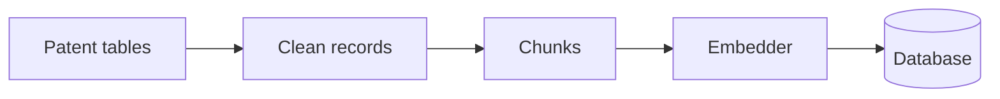
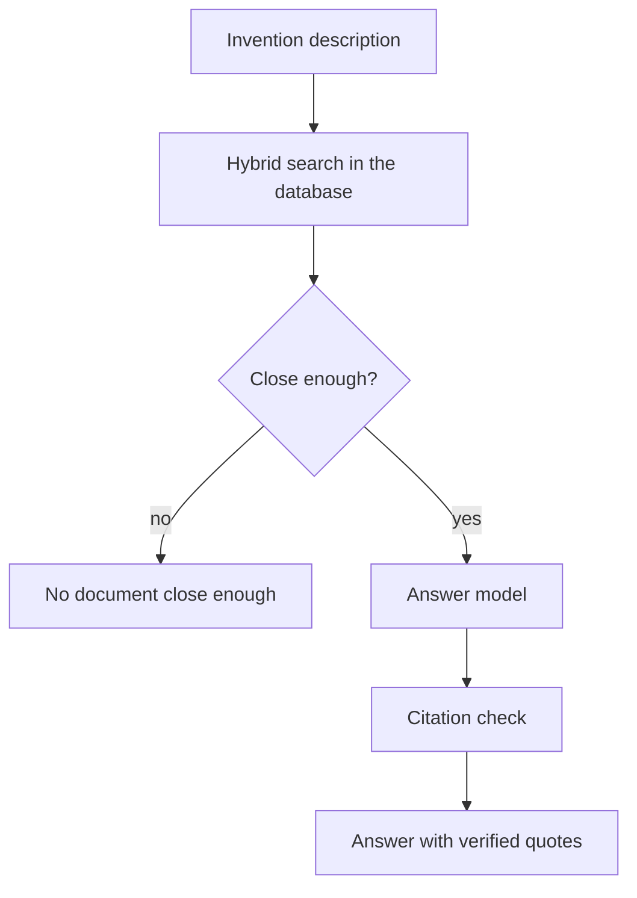

# Similar Patent Finder

You describe an invention in a few lines. The tool searches a collection of patents, shows the closest ones, and quotes the exact passage that makes each of them close. Every quote is checked against the patent text before it is shown.

## The problem

A patent gives its owner the exclusive right to use an invention, but only if the invention is new. So before filing, someone has to check whether anything like it has already been described. Any earlier public document that shows this is called **prior art** (in French, an antériorité. "Art" is the old sense of a craft, nothing to do with painting).

Two things make it hard. The same idea gets written in different words, so a wireless charger and an inductive power transfer device look unrelated to a keyword search. And a wrong answer is costly: a language model that invents a patent, or calls a document relevant when it is not, is worse than no tool.

## What the tool does

You paste a description. It returns up to ten patents, closest first, with the passages that match best.

A second mode adds a short comment from a language model on what is close and what is different, with one quote per patent. The model must copy an excerpt from the patent. The program then searches for that excerpt in the real patent text, like a Ctrl+F. If it is found, the quote is shown. If it is not, the model made it up or altered it, so the quote is removed and the whole answer is marked unreliable.

If nothing in the collection is close enough, the tool does not bluff. It says: you shall not pass.

There is a command line and a small web page. Both run on your own machine. Nothing is hosted online. The web page offers two collections: wireless power transfer, the one measured below, and coffee and beverage machines, a second collection that only illustrates the tool in another field.

## How I tested it

I measured the tool against what patent examiners actually found.

**The examiner.** When a patent application is filed, an employee of the patent office (here the USPTO) reviews it. The examiner is the person who decides whether your precious invention gets through the gate. To do that, the examiner searches for earlier patents that show the idea is not new, and lists the ones they retain on the granted patent, under "references cited". It is the same job the tool is meant to do.

**The test.**

1. I took a patent, let's call it "the One Ring". The examiner cited 5 earlier patents for it, and those 5 are in my collection. That list is the **answer key**. The tool never sees it.
2. I gave the tool the Ring's abstract (its short summary) and its **claim 1** (the legal sentence that defines what it protects), as if it were a new invention.
3. The tool ranks the other patents from closest to least close. The **top 10** are the ten at the head of that list, the ones a user sees first.
4. I count how many of the 5 are in the top 10. If 2 are, the score is 2 out of 5.
5. I repeat on many patents and average.

I used 70 patents chosen with a fixed random seed. The collection has 500 patents: those 70, the ones they cite, and random others from the same field.

**Two sets, on purpose.** 20 patents are the development set, used to try ideas and tune settings, so their scores are flattering. The other 50 are the test set. I ran it once per system, at the very end, after every setting was frozen. Like a trip to Mordor, there is no going back for a second try.

**Two scores.**

- **Found in the top 10** (recall at 10). The share of the answer key that appears in the first ten results. 0.43 means 43 percent of the patents the examiner cited.
- **Ranking score** (MRR, mean reciprocal rank). How fast a user hits a first good result. I take 1 divided by the position of the first cited patent: first place gives 1, second 0.5, tenth 0.1, absent 0. A score near 0.5 means the first good result sits around second place.

With 50 test patents a score can move by chance, so each comes with a plausible range. If two ranges overlap, the difference may be luck.

## Results

**In plain words**

- **It finds about four in ten.** The best systems recover 37 to 43 percent of the cited patents in their top ten. This is a measured starting point, not a finished product.
- **Searching by meaning did not clearly beat searching by keywords.** 43 percent against 37 percent can be luck with 50 patents, so I do not claim one is better.
- **Most misses are not search errors.** I read 15. Eleven were patents of the same field that the examiner cited as background, not because they describe the same invention. No tool that looks for the closest document would find those.
- **The quotes can be trusted.** 224 of 226 quotes were found word for word in the cited patent. The two others were removed and flagged.
- **It declines when nothing matches.** On 10 descriptions of electrical devices not in the collection, it declined 10 times with the open model and 9 with the paid one, and never declined a real query. Ten is a small check.

**Systems compared**

- **Keyword search.** Matches the words of the description against the patent text and favors rare words. BM25 is a refined form of TF-IDF. I also tried the full text search built into the database.
- **Semantic search.** An embedding model turns a text into a list of numbers so that texts with similar meaning get similar numbers, and the search finds the closest ones. Two models: **e5-small**, open and free on my machine, and **voyage-4-lite**, a paid web service.
- **Hybrid.** Runs both and merges the two rankings.

**Test set, 50 patents**, each system run once, with a 95 percent range in brackets:

| System | Found in top 5 | Found in top 10 | Ranking score |
|---|---|---|---|
| Keywords, BM25 | 0.32 | 0.37 (0.28 to 0.46) | 0.49 |
| Keywords, database search | 0.27 | 0.32 (0.24 to 0.40) | 0.43 |
| Semantic, e5-small | 0.29 | 0.35 (0.26 to 0.44) | 0.40 |
| Semantic, voyage-4-lite | 0.35 | 0.43 (0.34 to 0.52) | 0.52 |
| Hybrid, e5-small | 0.32 | 0.36 (0.27 to 0.45) | 0.42 |
| Hybrid, voyage-4-lite | 0.33 | 0.42 (0.33 to 0.51) | 0.47 |

No system clearly beats the others, plain BM25 included, because the ranges overlap. Merging the two searches did not help much either. I had expected a clearer win. The scores are also lower than on the development set (hybrid with e5-small: 0.36 against 0.47 in the top 10), which is what tuning on 20 patents does and why I kept a test set.

The cited answers and the refusal tests were run on the same 50 patents. Details, cost and speed are in [`docs/technical_notes.md`](docs/technical_notes.md).

## Where it fails

130 of the 208 expected references were not in the top 10. I read 15 of them (`eval/failure_analysis_final.md`). Eleven were patents of the same field that cover another aspect than the description: a circuit against a coil structure, say. That caps what any system can score on this answer key. Two were the same idea in other words, and two came from a thin description. Seven ranked between 9 and 29, so a longer candidate list or a reranking step could recover some. I read these alone, so the sorting is a judgment call.

## Limits

- The answer key only counts examiner citations inside my field and my collection, and a cited patent is not always the closest one. It measures agreement with examiners, not truth.
- Only abstracts and claims are indexed, not the long descriptions.
- 500 patents is small, and 50 test patents give wide ranges. US patents in English only.
- The models are general purpose. The two embedding models and the language model that writes the comments were not specialized or trained on legal, intellectual property or patent data, and I did not test models that were.
- A verified quote proves the text exists in the patent. It does not prove the model's comment about it is right.

## How it works

Patent texts are cut into pieces, one per abstract and one per claim. Each piece becomes a list of numbers through the embedding model. Text, numbers and a keyword index live in one PostgreSQL database with the pgvector extension. A search runs by keywords and by meaning, and the two rankings are merged. The embedding model and the answer model sit behind small interfaces, so changing a model is a setting and not a code change.





## Running it

You need Python 3.11 or newer and Docker.

```bash
git clone https://github.com/guillaumeoudin/similar-patent-finder.git
cd similar-patent-finder
python -m venv .venv && source .venv/bin/activate   # on Windows: .venv\Scripts\activate
pip install -e ".[dev,local]"
cp .env.example .env
docker compose -f docker_compose.yml up -d
python eval/build_dataset.py      # picks the evaluation collection
python -m priorart.ingest         # builds clean records
priorart index --yes              # embeds and stores
priorart search "a charging pad with a coil that detects metal objects"
priorart answer "a charging pad with a coil that detects metal objects"
```

The web page needs `pip install -e ".[api]"` and `uvicorn priorart.api:app`. It has no login, so do not expose it to a network. Choosing the embedding model, using a Claude subscription or an API key for the answers, and the tests are explained in [`docs/technical_notes.md`](docs/technical_notes.md).

## Data

The patents come from the PatentsView tables, distributed by the USPTO Open Data Portal. I kept one field, wireless power transfer (CPC group H02J 50), for patents granted from 2015 to 2025. The raw files are not in this repository. You download them yourself from the portal, which needs a free USPTO.gov account, and put them in `data/raw/`. `DATA_LICENSES.md` has the license statement and what I could and could not verify.

Data derived from PatentsView. This project is not endorsed by, or affiliated with, PatentsView or the USPTO.

## Disclaimer

This is a technical project. It does not tell you whether an invention is new or patentable, and it should not be used to make legal decisions.

## Next

Compare the web service models with open models on a remote GPU machine. Add a reranking step. Index description paragraphs.
